# 📋 Comprehensive Taxonomy & Master Bank of Common Survey Questions

> **Deep Research Reference Guide**  
> A rigorous methodological taxonomy and curated question bank spanning **psychometrics, market research, customer experience (CX), user experience (UX), product management, econometrics, organizational psychology (EX), clinical health outcomes (PROs), education, civic polling, and multimodal/gamified stealth assessment**.

---

## 🧭 Table of Contents

1. [Multi-Dimensional Classification Framework](#1-multi-dimensional-classification-framework)
   - [1.1 Visual Taxonomy Architecture](#11-visual-taxonomy-architecture)
   - [1.2 Classification by Stevens' Level of Measurement & Statistical Mapping](#12-classification-by-stevens-level-of-measurement--statistical-mapping)
2. [Classification by Structural & Psychometric Question Type](#2-classification-by-structural--psychometric-question-type)
   - [2.1 Closed-Ended Categorical Formats](#21-closed-ended-categorical-formats)
   - [2.2 Classical Attitude & Psychometric Scaling Techniques](#22-classical-attitude--psychometric-scaling-techniques)
   - [2.3 Comparative, Trade-Off & Econometric Choice Formats](#23-comparative-trade-off--econometric-choice-formats)
   - [2.4 Visual, Multimodal & Gamified Stealth Assessment Formats](#24-visual-multimodal--gamified-stealth-assessment-formats)
   - [2.5 Open-Ended Qualitative & Diagnostic Formats](#25-open-ended-qualitative--diagnostic-formats)
3. [The Master Survey Question Bank (Classified by Domain & Type)](#3-the-master-survey-question-bank-classified-by-domain--type)
   - [Domain 1: Customer Experience (CX), Loyalty & Service Quality (NPS, CSAT, CES, SERVQUAL)](#domain-1-customer-experience-cx-loyalty--service-quality)
   - [Domain 2: Product Management, SaaS & User Experience (PMF, SUS, UMUX-LITE, SEQ, NASA-TLX, Kano, Churn)](#domain-2-product-management-saas--user-experience-ux)
   - [Domain 3: Market Research, Brand Equity & Econometric Pricing (U&A, Van Westendorp, Gabor-Granger, Juster)](#domain-3-market-research-brand-equity--econometric-pricing)
   - [Domain 4: Employee Experience (EX) & Organizational Psychology (eNPS, Edmondson Psych Safety, Engagement)](#domain-4-employee-experience-ex--organizational-psychology)
   - [Domain 5: Healthcare, Clinical PROs & Subjective Well-Being (HCAHPS, PHQ-9, GAD-7, SF-36, PROMIS, WHO-5)](#domain-5-healthcare-clinical-pros--subjective-well-being)
   - [Domain 6: Education, Academic Evaluation & L&D Training (Kirkpatrick 4 Levels)](#domain-6-education-academic-evaluation--ld-training)
   - [Domain 7: Event, Conference & Hospitality Feedback](#domain-7-event-conference--hospitality-feedback)
   - [Domain 8: Civic, Public Policy & Political Polling](#domain-8-civic-public-policy--political-polling)
   - [Domain 9: Screening, Standard Demographics & B2B Firmographics](#domain-9-screening-standard-demographics--b2b-firmographics)
   - [Domain 10: Data Quality, Attention Checks (IMCs) & Bias Control](#domain-10-data-quality-attention-checks-imcs--bias-control)
4. [Standardized Response Anchor Lexicon (5-Point & 7-Point Scales)](#4-standardized-response-anchor-lexicon-5-point--7-point-scales)
5. [Survey Design Pitfalls, Cognitive Biases & Mitigation Matrix](#5-survey-design-pitfalls-cognitive-biases--mitigation-matrix)

---

## 1. Multi-Dimensional Classification Framework

In modern survey methodology and psychometrics, any survey question is uniquely classified along **four orthogonal dimensions**:
1. **Structural / Mechanical Format:** How the respondent physically interacts with the stimulus and inputs data (e.g., radio button, Likert matrix, MaxDiff subset, continuous slider, 3D in-game action).
2. **Psychometric & Statistical Scale (Stevens' Typology):** The mathematical properties of the resulting data (**Nominal**, **Ordinal**, **Interval**, **Ratio**) which dictate valid statistical analyses.
3. **Cognitive & Methodological Function:** What mental construct the question targets (**Screener**, **Behavioral/RFM**, **Attitudinal/Affective**, **Psychographic**, **Predictive Intent**, **Knowledge**, or **Validity/Attention Check**).
4. **Application Domain & Validated Instrument:** Whether the item belongs to an ad-hoc questionnaire or a psychometrically validated instrument (e.g., **SUS**, **NPS**, **SERVQUAL**, **PHQ-9**, **WHO-5**, **Van Westendorp PSM**).

### 1.1 Visual Taxonomy Architecture

```mermaid
flowchart TD
    Root["Survey Question Taxonomy"] --> A1["1. Structural & Input Format"]
    Root --> A2["2. Stevens' Measurement Level"]
    Root --> A3["3. Cognitive & Methodological Role"]
    Root --> A4["4. Domain & Validated Scales"]

    A1 --> S1["Closed Categorical (Binary, Single/Multi-Select)"]
    A1 --> S2["Psychometric Scales (Likert, Semantic Diff, Stapel, Thurstone, Guttman)"]
    A1 --> S3["Comparative & Econometric (Rank, Constant Sum, MaxDiff, Conjoint, Kano, PSM)"]
    A1 --> S4["Multimodal & Gamified (Audio/Video Dial, Heatmap, Card Sort, Stealth Biometrics)"]
    A1 --> S5["Open-Ended Qualitative (Narrative, Short Recall, Numeric Open, Why-Probes)"]

    A2 --> M1["Nominal (Unordered Categories)"]
    A2 --> M2["Ordinal (Ordered Ranks)"]
    A2 --> M3["Interval (Equal Distance, Arbitrary Zero)"]
    A2 --> M4["Ratio (Equal Distance, Absolute Zero)"]

    A3 --> C1["Screeners & Filtering"]
    A3 --> C2["Behavioral (Past Action / RFM)"]
    A3 --> C3["Attitudinal & Perceptual"]
    A3 --> C4["Predictive & Purchase Intent"]
    A3 --> C5["Demographics & Firmographics"]
    A3 --> C6["Attention Checks (IMCs) & Trap Items"]

    A4 --> D1["CX & Loyalty (NPS, CSAT, CES, SERVQUAL)"]
    A4 --> D2["UX & Product (SUS, SEQ, PMF, NASA-TLX)"]
    A4 --> D3["Market & Pricing (U&A, Van Westendorp, Gabor-Granger)"]
    A4 --> D4["EX & Org Psych (eNPS, Edmondson Safety)"]
    A4 --> D5["Clinical & Health (HCAHPS, PHQ-9, GAD-7, WHO-5)"]
```

### 1.2 Classification by Stevens' Level of Measurement & Statistical Mapping

| Measurement Level | Mathematical Property | Typical Question Types | Central Tendency & Dispersion | Valid Parametric / Non-Parametric Tests |
| :--- | :--- | :--- | :--- | :--- |
| **Nominal** | Categorizes without order ($A \neq B$) | Binary (Yes/No), Single-Select Multiple Choice, Multi-Select Checkboxes, Aided Brand Recall, Open Card Sort | Mode, Frequency %, Cross-tabulation | Chi-Square ($\chi^2$), Fisher's Exact Test, McNemar's Test, Cramér's $V$ |
| **Ordinal** | Preserves rank order ($A > B > C$), unequal intervals | Single Likert Item, Rank Order, Guttman Scale, Sean Ellis PMF, Customer Effort (single item) | Median, Mode, Interquartile Range (IQR) | Mann-Whitney $U$, Wilcoxon Signed-Rank, Kruskal-Wallis $H$, Spearman's $\rho$, Kendall's $\tau$, Ordinal Logistic Regression |
| **Interval** | Equal intervals between points ($\Delta_{1\to 2} = \Delta_{4\to 5}$), arbitrary zero | Summated Multi-Item Likert Scale (e.g., SUS, Edmondson), Semantic Differential, Stapel Scale, Thurstone Scale | Arithmetic Mean ($\mu$), Standard Deviation ($\sigma$), Variance ($\sigma^2$) | Student's $t$-test, ANOVA, Pearson's $r$, OLS Linear Regression, Exploratory/Confirmatory Factor Analysis (EFA/CFA), Cronbach's $\alpha$ |
| **Ratio** | Equal intervals + true absolute zero ($0 = \text{complete absence}$) | Constant Sum (100-pt allocation), Van Westendorp Price ($), Numeric Open-End (Age, Tenure, Frequency Count), Reaction-Time Biometrics (ms) | Arithmetic Mean, Geometric Mean, Harmonic Mean, Coefficient of Variation ($CV = \sigma/\mu$) | All Interval tests + Log-Linear Models, Survival/Hazard Analysis, Price Elasticity ($\epsilon_p$), Multinomial Logit Demand |

---

## 2. Classification by Structural & Psychometric Question Type

### 2.1 Closed-Ended Categorical Formats

| Question Type | Structural Code | Mechanism & Description | Primary Strengths | Methodological Limitations |
| :--- | :--- | :--- | :--- | :--- |
| **Dichotomous / Binary Choice** | `CLOSED-BIN` | Forces a choice between exactly two mutually exclusive options (*Yes/No*, *True/False*, *Agree/Disagree*, *Option A vs. B*). | Fastest cognitive completion time; ideal for qualifying screeners and clear branching logic. | Oversimplifies nuanced attitudes; loses variance and intensity information. |
| **Single-Select Multiple Choice (Polytomous)** | `CLOSED-MC1` | Respondent selects **one** option from $k \ge 3$ mutually exclusive and collectively exhaustive (MECE) choices (Radio buttons or Dropdown). | Clean nominal data; easy to tabulate and cross-segment. | Vulnerable to **primacy bias** (choosing first options) unless options are randomized; requires an *"Other (please specify)"* escape hatch for exhaustiveness. |
| **Multi-Select Multiple Choice (Checkboxes)** | `CLOSED-MCK` | Respondent selects **all options that apply** (or *up to $k$ options*) from a list of non-exclusive items. | Captures breadth of usage, multi-brand awareness, or feature ensembles. | Prone to acquiescence/over-selection; each option behaves statistically as an independent binary variable. |
| **Dropdown Menu** | `CLOSED-DD` | Compact single-select list hidden until clicked (used for long lists such as Country, State, Industry, or Birth Year). | Saves vertical screen space for long, well-known objective lists. | Poor for attitudinal questions because options are hidden from initial visual inspection; requires extra clicks. |

---

### 2.2 Classical Attitude & Psychometric Scaling Techniques

#### 1. Likert Scale (Summated Rating Scale — Rensis Likert, 1932)
* **Code:** `SCALE-LIKERT`
* **Mechanism:** Respondents evaluate a declarative statement along a symmetrical bipolar agreement continuum (typically 5-point or 7-point, from *Strongly Disagree* to *Strongly Agree*), or evaluate unipolar/bipolar constructs (Frequency, Satisfaction, Importance, Likelihood).
* **Psychometric Note:** A single item is strictly **ordinal**; a composite score summed or averaged across multiple correlated Likert items (a *Likert scale* proper, verified via Cronbach's $\alpha \ge 0.70$) approximates **interval** measurement.

#### 2. Numeric & Linear Rating Scale (NRS)
* **Code:** `SCALE-NUM`
* **Mechanism:** Evaluates intensity, likelihood, or global quality on an end-anchored numeric continuum (e.g., `0–10` in Net Promoter Score, `1–5` Star Rating, or `1–10` Hospital Global Rating) where only the extremes—and optionally the midpoint—have verbal labels.
* **Psychometric Note:** Reduces translation bias across international surveys because numbers carry fewer linguistic nuances than intermediate adjectives.

#### 3. Semantic Differential Scale (Charles E. Osgood, 1957)
* **Code:** `SCALE-SEMDIFF`
* **Mechanism:** Measures the connotative psychological meaning of a concept, brand, or interface across a 5- or 7-point continuum anchored by **bipolar antonym adjectives**.
* **Three Canonical Osgood Dimensions:**
  1. **Evaluation (Good–Bad):** *Trustworthy ↔ Untrustworthy*, *Valuable ↔ Worthless*, *Pleasant ↔ Unpleasant*
  2. **Potency (Strong–Weak):** *Powerful ↔ Weak*, *Robust ↔ Fragile*, *Bold ↔ Timid*
  3. **Activity (Active–Passive):** *Fast ↔ Slow*, *Dynamic ↔ Static*, *Innovative ↔ Traditional*

#### 4. Stapel Scale (Jan Stapel)
* **Code:** `SCALE-STAPEL`
* **Mechanism:** A 10-point unipolar nonverbal rating scale ranging from **$+5$ to $-5$ without a zero midpoint**, centered around a single adjective or phrase (e.g., *"Innovative"*, *"Fairly Priced"*).
* **Advantage:** Eliminates the difficulty of crafting true semantic opposites required by the Semantic Differential scale and forces a directional choice.

#### 5. Thurstone Scale (Equal-Appearing Intervals — L.L. Thurstone, 1929)
* **Code:** `SCALE-THURSTONE`
* **Mechanism:** An expert panel of judges first rates 80–100 candidate statements on an 11-point favorability scale. Statements with low inter-judge interquartile range ($Q$) and evenly spaced medians ($S$-weights from $1.0$ to $11.0$) are retained. Survey respondents simply check **Agree/Disagree** on each statement, and their attitude score is the mean scale weight $S$ of all endorsed items.

#### 6. Guttman Scale (Cumulative / Scalogram Analysis — Louis Guttman, 1944)
* **Code:** `SCALE-GUTTMAN`
* **Mechanism:** Arranges binary statements in a strict unidimensional hierarchy of intensity. Endorsing item $k$ logically implies endorsing all less extreme items $1, \dots, k-1$ (e.g., Bogardus Social Distance Scale or cumulative product adoption milestones).
* **Validation Metric (Coefficient of Reproducibility):**
  $$\text{CR} = 1 - \frac{E}{N \times K}$$
  where $E$ is the number of scaling errors (departures from ideal cumulative patterns), $N$ is sample size, and $K$ is number of items ($\text{CR} \ge 0.90$ indicates a valid unidimensional Guttman scale).

#### 7. Matrix / Grid & Bi-Dimensional Side-by-Side Tables
* **Code:** `SCALE-MATRIX`
* **Mechanism:** Condenses multiple statements (rows) sharing identical scale anchors (columns) into a single table. A **Side-by-Side Matrix** captures two dimensions simultaneously for each row (e.g., *Importance* on the left vs. *Current Satisfaction* on the right to compute **Importance-Satisfaction Opportunity Scores**).
* **Opportunity Score Formula (Ulwick / Outcome-Driven Innovation):**
  $$\text{Opportunity} = \text{Importance} + \max(\text{Importance} - \text{Satisfaction}, 0)$$

#### 8. Continuous Slider & Visual Analog Scale (VAS)
* **Code:** `SCALE-VAS`
* **Mechanism:** Respondents drag an interactive slider along a continuous line (e.g., `0.0` to `100.0`) or graphical thermometer/facial expression continuum. Widely used in clinical pain measurement and feeling thermometers in political science.

---

### 2.3 Comparative, Trade-Off & Econometric Choice Formats

Standard rating scales suffer from **scale inflation** (where respondents rate every feature *"5/5 Very Important"*). Comparative and econometric question formats force realistic resource trade-offs.

#### 1. Rank Order & Paired Comparison
* **Code:** `COMP-RANK` / `COMP-PAIRED`
* **Mechanism:**
  * **Drag-and-Drop Rank Order:** Orders $k$ items from $1^{\text{st}}$ (most preferred) to $k^{\text{th}}$ (least preferred). Best limited to $k \le 7$ items to avoid working-memory overload.
  * **Paired Comparison (Thurstone Case V / Bradley-Terry Model):** Presents items two at a time across $\binom{k}{2} = \frac{k(k-1)}{2}$ pairs, asking *"Which of these two do you prefer?"*

#### 2. Constant Sum / Point Allocation
* **Code:** `COMP-CONSTSUM`
* **Mechanism:** Respondents allocate a fixed budget of **100 points** (or **\$100**) across $k$ attributes or categories so that $\sum_{i=1}^k w_i = 100$.
* **Statistical Advantage:** Produces true **ratio-scale** data: an attribute given $40$ points is valued exactly twice as much as one given $20$ points.

#### 3. MaxDiff (Maximum Difference / Best-Worst Scaling — Louviere, 1987)
* **Code:** `COMP-MAXDIFF`
* **Mechanism:** Across multiple experimental screens, respondents view balanced subsets of 4–5 items from a larger master list (e.g., 15–30 features) and select **only two items per screen**: **Most Important (Best)** and **Least Important (Worst)**.
* **Utility Estimation:** Scored via Hierarchical Bayes (HB) multinomial logit or normalized Best-Minus-Worst counts:
  $$\text{MaxDiff Score}_i = \frac{B_i - W_i}{r_i \cdot N} \in [-1, +1]$$
  where $B_i$ and $W_i$ are the times item $i$ was chosen Best and Worst, and $r_i$ is the number of times item $i$ appeared per respondent.

#### 4. Discrete Choice Experiment (DCE) / Choice-Based Conjoint (CBC)
* **Code:** `ECON-CONJOINT`
* **Mechanism:** Simulates real-world purchasing by presenting 2–4 complete product bundles (defined by attributes like *Brand*, *Latency*, *Battery*, *Price*) plus a *"None of these"* option.
* **Random Utility Formulation (McFadden):**
  $$U_{nj} = V_{nj} + \varepsilon_{nj} = \sum_{k} \beta_k X_{njk} - \alpha P_{nj} + \varepsilon_{nj}, \quad P(\text{Choose } j) = \frac{\exp(V_{nj})}{\sum_{m} \exp(V_{nm})}$$
  Allows direct calculation of attribute **Part-Worth Utilities** ($\beta_k$) and **Willingness to Pay** ($\text{WTP}_k = \beta_k / \alpha$).

#### 5. Kano Model Paired Questions (Noriaki Kano, 1984)
* **Code:** `ECON-KANO`
* **Mechanism:** Evaluates each candidate feature using **two paired questions**:
  1. **Functional Form:** *"If the product HAS [Feature X], how do you feel?"*
  2. **Dysfunctional Form:** *"If the product DOES NOT HAVE [Feature X], how do you feel?"*
* **Standard 5-Option Kano Anchors (Must use exact asymmetrical phrasing):**
  1. I like it that way.
  2. It must be that way (I expect it).
  3. I am neutral.
  4. I can live with it that way (I tolerate it).
  5. I dislike it that way.
* **Cross-Classification Matrix:** Classifies every feature into **Must-Be ($M$)**, **One-Dimensional / Performance ($O$)**, **Attractive / Delighter ($A$)**, **Indifferent ($I$)**, **Reverse ($R$)**, or **Questionable ($Q$)**.

#### 6. Van Westendorp Price Sensitivity Meter (PSM — Peter van Westendorp, 1976)
* **Code:** `ECON-VWPSM`
* **Mechanism:** Uses four open-ended or slider price threshold questions (*Too Cheap*, *Bargain/Cheap*, *Expensive*, *Too Expensive*) to plot four cumulative distribution curves and identify:
  * **Point of Marginal Cheapness (PMC):** Intersection of *Too Cheap* and *Not Cheap*.
  * **Point of Marginal Expensive (PME):** Intersection of *Too Expensive* and *Not Expensive*.
  * **Indifference Price Point (IPP):** Intersection of *Cheap* and *Expensive*.
  * **Optimal Price Point (OPP):** Intersection of *Too Cheap* and *Too Expensive*.

#### 7. Gabor-Granger Price Ladder & Logit Demand Curve
* **Code:** `ECON-GABOR`
* **Mechanism:** Iteratively asks buy-intent across predetermined price tiers ($P_1, P_2, \dots, P_m$) to fit a continuous demand curve and price elasticity of demand:
  $$Q(P) = \frac{N}{1 + \exp\left(\beta \cdot (P - \mu_{\text{WTP}})\right)}, \quad \epsilon(P) = \frac{dQ/Q}{dP/P} = -\beta \cdot P \cdot \left(1 - \frac{Q(P)}{N}\right)$$

---

### 2.4 Visual, Multimodal & Gamified Stealth Assessment Formats

| Question Type | Structural Code | Mechanism & Description | Primary Use Cases |
| :--- | :--- | :--- | :--- |
| **Visual Image Choice (A/B/n)** | `VIS-IMAGE` | Respondents select or rate graphic cards, packaging mockups, UI screenshots, or brand logos. | Packaging design, ad creative testing, thumbnail/icon optimization. |
| **Spatial Heatmap / Click Test** | `VIS-HEATMAP` | Captures $(x,y)$ click coordinates and click latency on an image or UI wireframe (e.g., *"Click the first area that draws your eye"* or *"Click where you would go to upgrade"*). | First-click usability testing, landing page visual hierarchy, shelf-display attention. |
| **Card Sorting (Open & Closed)** | `VIS-CARDSORT` | Respondents drag digital cards into groups (**Open:** user invents group labels; **Closed:** user sorts into predefined buckets). | Information architecture (IA), navigation menu taxonomy, mental model discovery. |
| **Multimodal Audio / Video Stimulus** | `MULTI-AV` | Plays synthesized or recorded audio signatures, sonic logos, or video ad cuts before or during preference capture (including moment-to-moment continuous dial testing). | Sonic branding, trailer hook testing, podcast/voice UX, commercial pre-testing. |
| **Gamified Stealth Biometric Choice** | `GAME-STEALTH` | Embeds survey options via deterministic **1-to-1 Option Bijection** into interactive gameplay decisions (e.g., choosing a relic, upgrades, or resource trade-off) while capturing millisecond reaction time ($RT$). | Eliminates survey fatigue ($<2\%$ traditional completion) and weights explicit choice by implicit hesitation confidence: $C(RT) = \exp(-\lambda \max(0, RT - RT_{\text{base}}))$. |

---

### 2.5 Open-Ended Qualitative & Diagnostic Formats

| Question Type | Structural Code | Mechanism & Description | Analytical Approach |
| :--- | :--- | :--- | :--- |
| **Long-Text Narrative / Critical Incident** | `OPEN-LONG` | Multi-line text box inviting detailed storytelling, workflows, or edge-case frustrations. | Thematic coding, LLM sentiment/topic clustering, grounded theory analysis. |
| **Short-Text Unaided Recall / Word Association** | `OPEN-SHORT` | Single-line text box capturing top-of-mind awareness or 3-word brand associations. | Lexical frequency counts, lemmatized word clouds, first-mention share of mind. |
| **Diagnostic Follow-Up Probe ("Why?")** | `OPEN-PROBE` | Contextually branched open text immediately following a closed rating (e.g., NPS, CSAT, or Churn reason). | Driver linkage analysis (correlating text themes with Promoter vs. Detractor segments). |
| **Numeric Open-Ended** | `OPEN-NUM` | Text input restricted to valid integers or decimals (exact age, dollar spend, hours per week, team size). | Exact ratio-level descriptive statistics without artificial bracket truncation. |

---

## 3. The Master Survey Question Bank (Classified by Domain & Type)

Every question below is classified by:
* **ID:** Unique reference identifier
* **Question Text:** Gold-standard, non-leading phrasing
* **Question Type (`Code`):** Structural & psychometric classification
* **Measurement Level:** Nominal / Ordinal / Interval / Ratio
* **Standard Scale / Options:** Recommended response anchors

---

### Domain 1: Customer Experience (CX), Loyalty & Service Quality

#### 1A. Core Loyalty, Satisfaction & Friction Metrics (NPS, CSAT, CES 2.0)

| ID | Question Text | Question Type | Level | Scale / Response Options |
| :--- | :--- | :--- | :--- | :--- |
| `CX-01` | *"On a scale from 0 to 10, how likely are you to recommend [Company/Product] to a friend, colleague, or peer?"* | Numeric Rating (`SCALE-NUM` / **NPS**) | Ordinal / Interval | `0` (Not at all likely) to `10` (Extremely likely). Segments: `0–6` Detractors, `7–8` Passives, `9–10` Promoters. $\text{NPS} = \%P - \%D$. |
| `CX-02` | *"What is the primary reason for the score you just gave?"* | Diagnostic Probe (`OPEN-PROBE`) | Qualitative | Free-text input (branched by Detractor / Passive / Promoter). |
| `CX-03` | *"Overall, how satisfied or dissatisfied are you with your experience with [Company/Product] today?"* | Likert Satisfaction (`SCALE-LIKERT` / **CSAT**) | Ordinal | `1` Very Dissatisfied, `2` Somewhat Dissatisfied, `3` Neither Satisfied nor Dissatisfied, `4` Somewhat Satisfied, `5` Very Satisfied ($\text{CSAT} = \frac{\text{Count}(4,5)}{N} \times 100\%$). |
| `CX-04` | *"[Company] made it easy for me to handle my issue today."* | Likert Agreement (`SCALE-LIKERT` / **CES 2.0**) | Ordinal / Interval | 7-Point Agreement: `1` Strongly Disagree to `7` Strongly Agree. |
| `CX-05` | *"Did we completely resolve your issue during this interaction?"* | Dichotomous (`CLOSED-BIN` / **FCR**) | Nominal | `Yes, completely resolved` / `No, still unresolved` (First Contact Resolution). |
| `CX-06` | *"How many times did you have to contact us before your issue was resolved?"* | Single-Select (`CLOSED-MC1`) | Ordinal | `1 time (First contact)` / `2 times` / `3 times` / `4 or more times` / `My issue is still not resolved`. |

#### 1B. SERVQUAL Service Quality Battery (RATER Framework — Parasuraman, Zeithaml & Berry)

| ID | RATER Dimension | Question / Statement Text | Question Type | Level | Scale / Anchors |
| :--- | :--- | :--- | :--- | :--- | :--- |
| `CX-07` | **Tangibles** | *"[Company]'s physical facilities, digital interface, and visual materials are modern and visually appealing."* | Likert (`SCALE-LIKERT`) | Interval (Composite) | 7-Point Agreement (`1` Strongly Disagree – `7` Strongly Agree) |
| `CX-08` | **Reliability** | *"When [Company] promises to do something by a certain time, it does so dependably and accurately."* | Likert (`SCALE-LIKERT`) | Interval (Composite) | 7-Point Agreement (`1` Strongly Disagree – `7` Strongly Agree) |
| `CX-09` | **Reliability** | *"[Company] performs the service right the first time without errors."* | Likert (`SCALE-LIKERT`) | Interval (Composite) | 7-Point Agreement (`1` Strongly Disagree – `7` Strongly Agree) |
| `CX-10` | **Responsiveness** | *"Employees at [Company] give prompt service and are always willing to help customers."* | Likert (`SCALE-LIKERT`) | Interval (Composite) | 7-Point Agreement (`1` Strongly Disagree – `7` Strongly Agree) |
| `CX-11` | **Assurance** | *"The behavior and expertise of [Company]'s staff instill confidence and trust in me."* | Likert (`SCALE-LIKERT`) | Interval (Composite) | 7-Point Agreement (`1` Strongly Disagree – `7` Strongly Agree) |
| `CX-12` | **Empathy** | *"[Company] gives me individualized attention and has my best interests at heart."* | Likert (`SCALE-LIKERT`) | Interval (Composite) | 7-Point Agreement (`1` Strongly Disagree – `7` Strongly Agree) |

#### 1C. E-Commerce, Retail & Post-Purchase Fulfillment

| ID | Question Text | Question Type | Level | Scale / Response Options |
| :--- | :--- | :--- | :--- | :--- |
| `CX-13` | *"How satisfied were you with the speed and condition of your delivery?"* | Side-by-Side Matrix (`SCALE-MATRIX`) | Ordinal | Rows: `Delivery Speed`, `Packaging Condition`, `Tracking Updates`. Columns: `1` Very Dissatisfied – `5` Very Satisfied. |
| `CX-14` | *"Did the product you received match its online description and photos?"* | Likert Scale (`SCALE-LIKERT`) | Ordinal | `1` Completely Inaccurate – `5` Completely Accurate. |
| `CX-15` | *"How likely are you to purchase from [Company] again in the next 90 days?"* | Likert Likelihood (`SCALE-LIKERT`) | Ordinal | `1` Extremely Unlikely – `5` Extremely Likely. |

---

### Domain 2: Product Management, SaaS & User Experience (UX)

#### 2A. Product-Market Fit (Sean Ellis PMF Framework)

| ID | Question Text | Question Type | Level | Scale / Response Options |
| :--- | :--- | :--- | :--- | :--- |
| `UX-01` | *"How would you feel if you could no longer use [Product]?"* | Single-Select (`CLOSED-MC1` / **Sean Ellis PMF**) | Ordinal | `1` Very disappointed (Target benchmark: $\ge 40\%$), `2` Somewhat disappointed, `3` Not disappointed (it really isn't that useful), `4` N/A – I no longer use [Product]. |
| `UX-02` | *"What type of people do you think would benefit most from [Product]?"* | Open-Ended (`OPEN-LONG`) | Qualitative | Free-text persona description. |
| `UX-03` | *"What is the main benefit you receive from [Product]?"* | Open-Ended (`OPEN-SHORT`) | Qualitative | Free-text core value proposition. |
| `UX-04` | *"How can we improve [Product] for you?"* | Open-Ended (`OPEN-LONG`) | Qualitative | Free-text roadmap gap identification. |

#### 2B. System Usability Scale (SUS — Complete 10-Item Validated Instrument, John Brooke, 1986)

> **Scoring Formula:** Odd-numbered items ($1, 3, 5, 7, 9$) are positive tone: contribution is $(X_i - 1)$. Even-numbered items ($2, 4, 6, 8, 10$) are negative tone: contribution is $(5 - X_i)$. Sum all 10 contributions and multiply by $2.5$:
> $$\text{SUS Score} = 2.5 \times \left( \sum_{i \in \{1,3,5,7,9\}} (X_i - 1) + \sum_{j \in \{2,4,6,8,10\}} (5 - X_j) \right) \in [0, 100] \quad (\text{Benchmark Mean} = 68.0)$$

| ID | SUS Item # | Polarity | Exact Validated Statement | Question Type | Scale / Anchors |
| :--- | :--- | :--- | :--- | :--- | :--- |
| `UX-05` | Item 1 | Positive ($+$) | *"I think that I would like to use this system frequently."* | Likert (`SCALE-LIKERT`) | `1` Strongly Disagree – `5` Strongly Agree |
| `UX-06` | Item 2 | Negative ($-$) | *"I found the system unnecessarily complex."* | Likert (`SCALE-LIKERT`) | `1` Strongly Disagree – `5` Strongly Agree |
| `UX-07` | Item 3 | Positive ($+$) | *"I thought the system was easy to use."* | Likert (`SCALE-LIKERT`) | `1` Strongly Disagree – `5` Strongly Agree |
| `UX-08` | Item 4 | Negative ($-$) | *"I think that I would need the support of a technical person to be able to use this system."* | Likert (`SCALE-LIKERT`) | `1` Strongly Disagree – `5` Strongly Agree |
| `UX-09` | Item 5 | Positive ($+$) | *"I found the various functions in this system were well integrated."* | Likert (`SCALE-LIKERT`) | `1` Strongly Disagree – `5` Strongly Agree |
| `UX-10` | Item 6 | Negative ($-$) | *"I thought there was too much inconsistency in this system."* | Likert (`SCALE-LIKERT`) | `1` Strongly Disagree – `5` Strongly Agree |
| `UX-11` | Item 7 | Positive ($+$) | *"I would imagine that most people would learn to use this system very quickly."* | Likert (`SCALE-LIKERT`) | `1` Strongly Disagree – `5` Strongly Agree |
| `UX-12` | Item 8 | Negative ($-$) | *"I found the system very cumbersome to use."* | Likert (`SCALE-LIKERT`) | `1` Strongly Disagree – `5` Strongly Agree |
| `UX-13` | Item 9 | Positive ($+$) | *"I felt very confident using the system."* | Likert (`SCALE-LIKERT`) | `1` Strongly Disagree – `5` Strongly Agree |
| `UX-14` | Item 10 | Negative ($-$) | *"I needed to learn a lot of things before I could get going with this system."* | Likert (`SCALE-LIKERT`) | `1` Strongly Disagree – `5` Strongly Agree |

#### 2C. Ultra-Short Usability & Cognitive Load (UMUX-LITE, SEQ, NASA-TLX)

| ID | Instrument | Question / Statement Text | Question Type | Level | Scale / Response Options |
| :--- | :--- | :--- | :--- | :--- | :--- |
| `UX-15` | **UMUX-LITE (Item 1: Utility)** | *"This system's capabilities meet my requirements."* | Likert (`SCALE-LIKERT`) | Interval | 7-Point Agreement (`1` Strongly Disagree – `7` Strongly Agree) |
| `UX-16` | **UMUX-LITE (Item 2: Usability)** | *"This system is easy to use."* | Likert (`SCALE-LIKERT`) | Interval | 7-Point Agreement (`1` Strongly Disagree – `7` Strongly Agree) |
| `UX-17` | **Single Ease Question (SEQ)** | *"Overall, how difficult or easy was it to complete this task?"* | Semantic / Numeric (`SCALE-NUM`) | Ordinal / Interval | 7-Point Scale: `1` Very Difficult to `7` Very Easy (Administered immediately post-task). |
| `UX-18` | **NASA-TLX (Mental Demand)** | *"How mentally demanding was the task?"* | Continuous Slider (`SCALE-VAS`) | Interval | `0` (Very Low) to `100` (Very High) in 5-pt increments. |
| `UX-19` | **NASA-TLX (Temporal Demand)** | *"How hurried or rushed was the pace of the task?"* | Continuous Slider (`SCALE-VAS`) | Interval | `0` (Very Low) to `100` (Very High). |
| `UX-20` | **NASA-TLX (Performance)** | *"How successful were you in accomplishing what you were asked to do?"* | Continuous Slider (`SCALE-VAS`) | Interval | `0` (Perfect) to `100` (Failure). |
| `UX-21` | **NASA-TLX (Effort)** | *"How hard did you have to work to accomplish your level of performance?"* | Continuous Slider (`SCALE-VAS`) | Interval | `0` (Very Low) to `100` (Very High). |
| `UX-22` | **NASA-TLX (Frustration)** | *"How insecure, discouraged, irritated, stressed, and annoyed were you?"* | Continuous Slider (`SCALE-VAS`) | Interval | `0` (Very Low) to `100` (Very High). |

#### 2D. Feature Prioritization, Onboarding & B2B SaaS Churn

| ID | Sub-Domain | Question Text | Question Type | Level | Scale / Response Options |
| :--- | :--- | :--- | :--- | :--- | :--- |
| `UX-23` | **Kano Functional** | *"If [Product] includes [Feature X], how do you feel?"* | Kano Pair (`ECON-KANO`) | Nominal (Cross-tab) | `I like it that way` / `It must be that way` / `I am neutral` / `I can live with it` / `I dislike it`. |
| `UX-24` | **Kano Dysfunctional** | *"If [Product] DOES NOT include [Feature X], how do you feel?"* | Kano Pair (`ECON-KANO`) | Nominal (Cross-tab) | `I like it that way` / `It must be that way` / `I am neutral` / `I can live with it` / `I dislike it`. |
| `UX-25` | **MaxDiff Feature Trade-Off** | *"Looking at these 4 candidate capabilities, which ONE is MOST important to your workflow, and which ONE is LEAST important?"* | MaxDiff (`COMP-MAXDIFF`) | Interval / Ratio | Best / Worst radio columns across randomized 4-item subsets. |
| `UX-26` | **Constant Sum Roadmap** | *"You have $100 in R&D tokens. Distribute them across the following 5 product areas based on where you want us to invest next."* | Constant Sum (`COMP-CONSTSUM`) | Ratio | Numeric inputs summing strictly to `100`. |
| `UX-27` | **SaaS Onboarding** | *"Were you able to achieve your initial goal during today's setup session?"* | Dichotomous (`CLOSED-BIN`) | Nominal | `Yes, completely` / `Partially` / `No, I got stuck`. |
| `UX-28` | **SaaS Churn (Exit)** | *"What is the single primary reason you are canceling your subscription today?"* | Single-Select (`CLOSED-MC1`) | Nominal | `Too expensive` / `Missing critical features` / `Switched to another solution` / `Project ended / No longer needed` / `Too difficult to use` / `Reliability or bugs` / `Poor customer support`. |
| `UX-29` | **SaaS Win-Back** | *"What is one specific improvement or change that would convince you to return to [Product] in the future?"* | Open-Ended (`OPEN-PROBE`) | Qualitative | Free-text input. |

---

### Domain 3: Market Research, Brand Equity & Econometric Pricing

#### 3A. Brand Funnel, Awareness & Perception (U&A & Aaker Brand Personality)

| ID | Sub-Domain | Question Text | Question Type | Level | Scale / Response Options |
| :--- | :--- | :--- | :--- | :--- | :--- |
| `MKT-01` | **Unaided Awareness** | *"When you think of [Product Category], what is the very first brand that comes to mind?"* | Short Open-End (`OPEN-SHORT`) | Nominal (Coded) | Single text box (Measures **Top-of-Mind Awareness / TOMA**). |
| `MKT-02` | **Aided Awareness** | *"Which of the following [Product Category] brands have you heard of before today? Select all that apply."* | Multi-Select (`CLOSED-MCK`) | Nominal | Randomized list of target brand + key competitors + 1 plausible foil/phantom brand (for over-claiming calibration). |
| `MKT-03` | **Brand Consideration Funnel** | *"How would you describe your relationship with each of the following brands?"* | Matrix (`SCALE-MATRIX`) | Ordinal | Columns: `Never heard of` $\to$ `Heard of, never tried` $\to$ `Tried in the past` $\to$ `Use occasionally` $\to$ `My primary/preferred brand`. |
| `MKT-04` | **Usage Frequency (U&A)** | *"In a typical month, how often do you use or purchase products in [Category]?"* | Single-Select (`CLOSED-MC1`) | Ordinal | `Daily` / `Several times a week` / `Once a week` / `2–3 times a month` / `Once a month or less` / `Never`. |
| `MKT-05` | **Brand Semantic Differential** | *"Please rate [Brand Name] on each of the following word pairs:"* | Semantic Diff (`SCALE-SEMDIFF`) | Interval | 7-Point Bipolar: `Outdated (1) ↔ Cutting-Edge (7)`, `Unreliable (1) ↔ Dependable (7)`, `Overpriced (1) ↔ Great Value (7)`, `Exclusive (1) ↔ Accessible (7)`. |
| `MKT-06` | **Aaker Brand Personality** | *"If [Brand] were a person, how well would each of the following traits describe its personality?"* | Matrix (`SCALE-MATRIX`) | Interval | Rows (Aaker's 5 Dimensions): `Sincere (Down-to-earth, Honest)`, `Exciting (Daring, Imaginative)`, `Competent (Reliable, Intelligent)`, `Sophisticated (Upper-class, Charming)`, `Rugged (Outdoorsy, Tough)`. Scale: `1` Not at all descriptive – `5` Extremely descriptive. |

#### 3B. Econometric Pricing, Willingness-to-Pay (WTP) & Purchase Probability

| ID | Framework | Question Text | Question Type | Level | Scale / Response Options |
| :--- | :--- | :--- | :--- | :--- | :--- |
| `MKT-07` | **Van Westendorp PSM #1 (Too Cheap)** | *"At what price would you consider [Product] to be **so inexpensive** that you would doubt its quality and would not buy it?"* | Numeric / Slider (`ECON-VWPSM`) | Ratio | Currency input `$___` or continuous price slider. |
| `MKT-08` | **Van Westendorp PSM #2 (Bargain)** | *"At what price would you consider [Product] to be a **bargain**—a great buy for the money?"* | Numeric / Slider (`ECON-VWPSM`) | Ratio | Currency input `$___` or continuous price slider. |
| `MKT-09` | **Van Westendorp PSM #3 (Expensive)** | *"At what price would you consider [Product] to be starting to get **expensive**, so that it is not out of the question, but you would have to give some thought to buying it?"* | Numeric / Slider (`ECON-VWPSM`) | Ratio | Currency input `$___` or continuous price slider. |
| `MKT-10` | **Van Westendorp PSM #4 (Too Expensive)** | *"At what price would you consider [Product] to be **too expensive** to ever consider buying?"* | Numeric / Slider (`ECON-VWPSM`) | Ratio | Currency input `$___` or continuous price slider. |
| `MKT-11` | **Gabor-Granger Price Ladder** | *"If [Product] were available today at **[Price $P$ ]**, how likely would you be to purchase it?"* | Adaptive Ladder (`ECON-GABOR`) | Ordinal / Ratio | 5-Point Buy Intent (`Definitely would buy` to `Definitely would not buy`); branches up/down across price tiers $P_1 \dots P_m$. |
| `MKT-12` | **Juster 11-Point Purchase Probability** | *"Taking everything into account, what are the chances that you will buy [Product] within the next [Timeframe]?"* | Probability Scale (`SCALE-NUM` / **Juster**) | Ratio ($0.0 - 1.0$) | `10` Certain/practically certain (99 in 100) $\to$ `9` Almost sure (9 in 10) $\to$ `5` Fairly good possibility (5 in 10) $\to$ `1` Very slight possibility (1 in 10) $\to$ `0` No chance (0 in 100). |

#### 3C. Creative, Advertising & Multimodal Stimulus Testing

| ID | Sub-Domain | Question Text | Question Type | Level | Scale / Response Options |
| :--- | :--- | :--- | :--- | :--- | :--- |
| `MKT-13` | **Ad Message Clarity** | *"After viewing this video/creative, what do you believe is the main message it is trying to communicate?"* | Open-Ended (`OPEN-SHORT`) | Qualitative | Free-text recall check. |
| `MKT-14` | **Sonic Branding / Audio Synth** | *"Listen to the 4 audio signatures below. Which sonic profile best embodies a high-precision, next-generation brand?"* | Multimodal Audio (`MULTI-AV`) | Nominal | Audio player cards (`Track A` / `Track B` / `Track C` / `Track D`). |
| `MKT-15` | **Visual Packaging Heatmap** | *"Click on the part of this product packaging that caught your attention first."* | Spatial Heatmap (`VIS-HEATMAP`) | Ratio $(x,y)$ | Image click coordinate capture + time-to-first-click ($ms$). |

---

### Domain 4: Employee Experience (EX) & Organizational Psychology

#### 4A. Employee Net Promoter Score (eNPS) & Core Engagement

| ID | Construct | Question / Statement Text | Question Type | Level | Scale / Response Options |
| :--- | :--- | :--- | :--- | :--- | :--- |
| `EX-01` | **eNPS** | *"On a scale from 0 to 10, how likely are you to recommend [Organization] as a great place to work?"* | Numeric Rating (`SCALE-NUM` / **eNPS**) | Ordinal / Interval | `0` (Not at all likely) to `10` (Extremely likely). |
| `EX-02` | **Role Clarity** | *"I clearly understand what is expected of me in my role and how my work contributes to company goals."* | Likert (`SCALE-LIKERT`) | Ordinal / Interval | 5-Point Agreement (`1` Strongly Disagree – `5` Strongly Agree) |
| `EX-03` | **Resource Enablement** | *"I have access to the tools, equipment, and resources I need to do my job effectively."* | Likert (`SCALE-LIKERT`) | Ordinal / Interval | 5-Point Agreement (`1` Strongly Disagree – `5` Strongly Agree) |
| `EX-04` | **Recognition** | *"In the past two weeks, I have received meaningful recognition or praise for doing good work."* | Likert (`SCALE-LIKERT`) | Ordinal / Interval | 5-Point Agreement (`1` Strongly Disagree – `5` Strongly Agree) |
| `EX-05` | **Career Growth** | *"I see a clear path for career growth and professional development for myself at [Organization]."* | Likert (`SCALE-LIKERT`) | Ordinal / Interval | 5-Point Agreement (`1` Strongly Disagree – `5` Strongly Agree) |
| `EX-06` | **Retention Intent** | *"I rarely think about looking for a job at another company."* | Likert (`SCALE-LIKERT`) | Ordinal / Interval | 5-Point Agreement (`1` Strongly Disagree – `5` Strongly Agree) |

#### 4B. Amy Edmondson's 7-Item Team Psychological Safety Scale (1999)

> **Scoring Note:** Items `EX-07`, `EX-09`, and `EX-11` are **negatively worded (reverse-scored)** so that higher composite scores indicate stronger psychological safety.

| ID | Item # | Scoring | Exact Validated Statement | Question Type | Scale / Anchors |
| :--- | :--- | :--- | :--- | :--- | :--- |
| `EX-07` | Item 1 | Reverse ($R$) | *"If you make a mistake on this team, it is often held against you."* | Likert (`SCALE-LIKERT`) | 7-Point Agreement (`1` Strongly Disagree – `7` Strongly Agree) |
| `EX-08` | Item 2 | Forward ($+$) | *"Members of this team are able to bring up problems and tough issues."* | Likert (`SCALE-LIKERT`) | 7-Point Agreement (`1` Strongly Disagree – `7` Strongly Agree) |
| `EX-09` | Item 3 | Reverse ($R$) | *"People on this team sometimes reject others for being different."* | Likert (`SCALE-LIKERT`) | 7-Point Agreement (`1` Strongly Disagree – `7` Strongly Agree) |
| `EX-10` | Item 4 | Forward ($+$) | *"It is safe to take a risk on this team."* | Likert (`SCALE-LIKERT`) | 7-Point Agreement (`1` Strongly Disagree – `7` Strongly Agree) |
| `EX-11` | Item 5 | Reverse ($R$) | *"It is difficult to ask other members of this team for help."* | Likert (`SCALE-LIKERT`) | 7-Point Agreement (`1` Strongly Disagree – `7` Strongly Agree) |
| `EX-12` | Item 6 | Forward ($+$) | *"No one on this team would deliberately act in a way that undermines my efforts."* | Likert (`SCALE-LIKERT`) | 7-Point Agreement (`1` Strongly Disagree – `7` Strongly Agree) |
| `EX-13` | Item 7 | Forward ($+$) | *"Working with members of this team, my unique skills and talents are valued and utilized."* | Likert (`SCALE-LIKERT`) | 7-Point Agreement (`1` Strongly Disagree – `7` Strongly Agree) |

#### 4C. Manager Effectiveness, Burnout, DEI & Employee Lifecycle

| ID | Sub-Domain | Question / Statement Text | Question Type | Level | Scale / Response Options |
| :--- | :--- | :--- | :--- | :--- | :--- |
| `EX-14` | **Manager Coaching** | *"My manager provides actionable feedback that helps me improve my performance."* | Likert (`SCALE-LIKERT`) | Ordinal | 5-Point Agreement (`1` Strongly Disagree – `5` Strongly Agree) |
| `EX-15` | **Burnout & Workload** | *"How often do you feel emotionally drained or exhausted by your work at the end of the day?"* | Likert Frequency (`SCALE-LIKERT`) | Ordinal | `1` Never, `2` Rarely, `3` Sometimes, `4` Often, `5` Always. |
| `EX-16` | **Belonging & Inclusion** | *"I feel comfortable bringing my authentic self to work without fear of negative consequences."* | Likert (`SCALE-LIKERT`) | Ordinal | 5-Point Agreement (`1` Strongly Disagree – `5` Strongly Agree) |
| `EX-17` | **Employee Exit** | *"What prompted you to begin searching for a new opportunity outside [Organization]?"* | Multi-Select (`CLOSED-MCK`) | Nominal | `Compensation & benefits` / `Lack of career progression` / `Manager relationship` / `Company culture` / `Workload & burnout` / `Return-to-office / flexibility policy` / `Role change`. |

---

### Domain 5: Healthcare, Clinical PROs & Subjective Well-Being

#### 5A. HCAHPS Hospital Patient Experience (CMS Standardized Items)

| ID | Domain | Exact Standardized Question | Question Type | Level | Scale / Response Options |
| :--- | :--- | :--- | :--- | :--- | :--- |
| `HLT-01` | **Nurse Communication** | *"During this hospital stay, how often did nurses treat you with courtesy and respect?"* | Frequency (`SCALE-LIKERT`) | Ordinal | `1` Never, `2` Sometimes, `3` Usually, `4` Always |
| `HLT-02` | **Doctor Communication** | *"During this hospital stay, how often did doctors explain things in a way you could understand?"* | Frequency (`SCALE-LIKERT`) | Ordinal | `1` Never, `2` Sometimes, `3` Usually, `4` Always |
| `HLT-03` | **Staff Responsiveness** | *"During this hospital stay, after you pressed the call button, how often did you get help as soon as you wanted it?"* | Frequency (`SCALE-LIKERT`) | Ordinal | `1` Never, `2` Sometimes, `3` Usually, `4` Always / `I never pressed the call button` |
| `HLT-04` | **Medication Communication** | *"Before giving you any new medicine, how often did hospital staff describe possible side effects in a way you could understand?"* | Frequency (`SCALE-LIKERT`) | Ordinal | `1` Never, `2` Sometimes, `3` Usually, `4` Always |
| `HLT-05` | **Global Hospital Rating** | *"Using any number from 0 to 10, where 0 is the worst hospital possible and 10 is the best hospital possible, what number would you use to rate this hospital during your stay?"* | Numeric Rating (`SCALE-NUM`) | Ordinal / Interval | `0` (Worst hospital possible) to `10` (Best hospital possible) |

#### 5B. Clinical Screening & Quality of Life (SF-36, PROMIS, PHQ-9, GAD-7, WHO-5)

| ID | Instrument | Exact Question / Stem & Item | Question Type | Level | Scale / Response Options |
| :--- | :--- | :--- | :--- | :--- | :--- |
| `HLT-06` | **SF-36 / RAND-36 (Item 1)** | *"In general, would you say your health is:"* | Single-Select (`SCALE-LIKERT`) | Ordinal | `1` Excellent, `2` Very good, `3` Good, `4` Fair, `5` Poor |
| `HLT-07` | **PROMIS Pain Interference** | *"In the past 7 days, how much did pain interfere with your day-to-day activities?"* | Likert (`SCALE-LIKERT`) | Ordinal / Interval ($T$-score) | `1` Not at all, `2` A little bit, `3` Somewhat, `4` Quite a bit, `5` Very much |
| `HLT-08` | **PHQ-9 (Anhedonia & Mood)** | *"Over the last 2 weeks, how often have you been bothered by: (1) Little interest or pleasure in doing things? (2) Feeling down, depressed, or hopeless?"* | Clinical Matrix (`SCALE-MATRIX`) | Interval (Sum $0–27$) | `0` Not at all, `1` Several days, `2` More than half the days, `3` Nearly every day |
| `HLT-09` | **GAD-7 (Anxiety Screening)** | *"Over the last 2 weeks, how often have you been bothered by: (1) Feeling nervous, anxious, or on edge? (2) Not being able to stop or control worrying?"* | Clinical Matrix (`SCALE-MATRIX`) | Interval (Sum $0–21$) | `0` Not at all, `1` Several days, `2` More than half the days, `3` Nearly every day |
| `HLT-10` | **WHO-5 Well-Being Index** | *"Over the last two weeks: (1) I have felt cheerful and in good spirits. (2) I have felt calm and relaxed. (3) I have felt active and vigorous. (4) I woke up feeling fresh and rested. (5) My daily life has been filled with things that interest me."* | Clinical Matrix (`SCALE-MATRIX`) | Interval ($0–100$ via $\sum \times 4$) | `5` All of the time, `4` Most of the time, `3` More than half of the time, `2` Less than half of the time, `1` Some of the time, `0` At no time |

---

### Domain 6: Education, Academic Evaluation & L&D Training (Kirkpatrick 4 Levels)

| ID | Kirkpatrick Level | Question Text | Question Type | Level | Scale / Response Options |
| :--- | :--- | :--- | :--- | :--- | :--- |
| `EDU-01` | **Level 1: Reaction** | *"The course content was engaging, well-organized, and relevant to my goals."* | Likert (`SCALE-LIKERT`) | Ordinal | 5-Point Agreement (`1` Strongly Disagree – `5` Strongly Agree) |
| `EDU-02` | **Level 1: Pacing & Load** | *"How would you rate the overall pace and weekly workload of this course?"* | Bipolar Scale (`SCALE-LIKERT`) | Ordinal | `1` Much too slow/light, `2` Somewhat slow/light, `3` Just right, `4` Somewhat fast/heavy, `5` Much too fast/heavy |
| `EDU-03` | **Level 2: Learning** | *"How confident do you feel in your ability to [perform specific learning objective] after completing this module?"* | Self-Efficacy (`SCALE-LIKERT`) | Ordinal | `1` Not at all confident – `5` Extremely confident (Often paired with Pre-Course baseline). |
| `EDU-04` | **Level 2: Instructor Clarity** | *"How effectively did the instructor explain complex concepts and respond to student questions?"* | Likert (`SCALE-LIKERT`) | Ordinal | `1` Not at all effectively – `5` Extremely effectively |
| `EDU-05` | **Level 3: Behavior Transfer** | *"Within the next 30 days, how likely are you to apply the frameworks learned in this training to your daily work?"* | Likelihood (`SCALE-LIKERT`) | Ordinal | `1` Extremely unlikely – `5` Extremely likely |
| `EDU-06` | **Level 4: Results & Critique** | *"Which specific module or assignment was most valuable to your learning, and what one change would most improve this course?"* | Open-Ended (`OPEN-LONG`) | Qualitative | Free-text formative/summative critique. |

---

### Domain 7: Event, Conference & Hospitality Feedback

| ID | Sub-Domain | Question Text | Question Type | Level | Scale / Response Options |
| :--- | :--- | :--- | :--- | :--- | :--- |
| `EVT-01` | **Overall Event Rating** | *"Overall, how did [Event Name] compare to your initial expectations?"* | Expectation Scale (`SCALE-LIKERT`) | Ordinal | `1` Fell far below expectations, `2` Fell somewhat below, `3` Met expectations, `4` Exceeded expectations, `5` Far exceeded expectations |
| `EVT-02` | **Multi-Aspect Matrix** | *"Please rate your satisfaction with each of the following aspects of [Event Name]:"* | Matrix (`SCALE-MATRIX`) | Ordinal | Rows: `Keynote Speakers`, `Breakout Sessions`, `Networking Opportunities`, `Venue & Audio/Visual`, `Registration & App`. Scale: `1` Very Dissatisfied – `5` Very Satisfied. |
| `EVT-03` | **Session Attribution** | *"Which session or speaker delivered the highest actionable value for you?"* | Single-Select / Open (`OPEN-SHORT`) | Nominal | Dropdown of sessions + open-text *"Why?"* |
| `EVT-04` | **Repeat Attendance** | *"How likely are you to attend [Event Name] next year?"* | Likelihood (`SCALE-LIKERT`) | Ordinal | `1` Definitely will not attend – `5` Definitely will attend |

---

### Domain 8: Civic, Public Policy & Political Polling

| ID | Construct | Question Text | Question Type | Level | Scale / Response Options |
| :--- | :--- | :--- | :--- | :--- | :--- |
| `CIV-01` | **Direction of Country / Community** | *"Generally speaking, would you say things in [Country/City] today are heading in the right direction, or have they gotten off on the wrong track?"* | Dichotomous + DK (`CLOSED-BIN`) | Nominal | `Right direction` / `Wrong track` / `Unsure / Don't know` (Randomize first two options to prevent order bias). |
| `CIV-02` | **Executive / Institutional Approval** | *"Do you approve or disapprove of the way [Institution/Official] is handling [Policy Area]?"* | Bipolar Scale (`SCALE-LIKERT`) | Ordinal | `Strongly approve` / `Somewhat approve` / `Somewhat disapprove` / `Strongly disapprove` / `No opinion`. |
| `CIV-03` | **Issue Salience (Most Important Problem)** | *"Which ONE of the following issues is most important to you right now?"* | Single-Select (`CLOSED-MC1`) | Nominal | `Economy & Cost of Living` / `Healthcare` / `Education` / `Public Safety` / `Climate & Environment` / `Infrastructure` / `Other`. |
| `CIV-04` | **Feeling Thermometer** | *"On a scale from 0 to 100—where 0 means very cold or unfavorable, 50 means neutral, and 100 means very warm or favorable—how do you feel toward [Group/Policy/Figure]?"* | Visual Analog Slider (`SCALE-VAS`) | Interval | Continuous `0` to `100` thermometer slider. |
| `CIV-05` | **Balanced Policy Trade-Off** | *"Some people say [Policy Position A], while others say [Policy Position B]. Which statement comes closer to your view, even if neither is exactly right?"* | Forced Choice (`CLOSED-BIN`) | Nominal | Balanced third-person framing (Mitigates acquiescence and social desirability bias). |

---

### Domain 9: Screening, Standard Demographics & B2B Firmographics

#### 9A. Qualification Screeners

| ID | Purpose | Question Text | Question Type | Level | Best-Practice Design |
| :--- | :--- | :--- | :--- | :--- | :--- |
| `SCR-01` | **Industry Exclusion Screener** | *"Do you or any member of your immediate household work in any of the following industries? Select all that apply."* | Multi-Select (`CLOSED-MCK`) | Nominal | Include target industry + `Market Research / Advertising` + 4 distractor industries + `None of the above` (Avoids revealing which option disqualifies/qualifies the respondent). |
| `SCR-02` | **Behavioral Recency Screener** | *"Which of the following activities have you personally done in the past 30 days? Select all that apply."* | Multi-Select (`CLOSED-MCK`) | Nominal | Mask target behavior among 4–5 plausible activities so respondents cannot guess the qualification criterion. |

#### 9B. Inclusive Individual Demographics (Placed at End of Survey unless Needed for Quotas)

| ID | Variable | Question Text | Question Type | Level | Standard Response Categories |
| :--- | :--- | :--- | :--- | :--- | :--- |
| `DEM-01` | **Age (Bracketed)** | *"Which category includes your current age?"* | Single-Select (`CLOSED-MC1`) | Ordinal | `Under 18` / `18–24` / `25–34` / `35–44` / `45–54` / `55–64` / `65 or older` / `Prefer not to say` (Mutually exclusive boundaries—never overlap like `20–30, 30–40`). |
| `DEM-02` | **Gender Identity** | *"How do you currently describe your gender identity?"* | Single-Select (`CLOSED-MC1`) | Nominal | `Woman` / `Man` / `Non-binary` / `Prefer to self-describe: [___]` / `Prefer not to say`. |
| `DEM-03` | **Education Attainment** | *"What is the highest level of formal education you have completed?"* | Single-Select (`CLOSED-MC1`) | Ordinal | `Less than high school diploma` / `High school graduate or GED` / `Some college, no degree` / `Associate or technical degree` / `Bachelor's degree` / `Master's, professional, or doctoral degree` / `Prefer not to say`. |
| `DEM-04` | **Employment Status** | *"Which of the following best describes your current employment status?"* | Single-Select (`CLOSED-MC1`) | Nominal | `Employed full-time` / `Employed part-time` / `Self-employed / Freelance` / `Unemployed (looking for work)` / `Student` / `Retired` / `Homemaker / Caregiver` / `Prefer not to say`. |
| `DEM-05` | **Household Income** | *"What was your total annual household income before taxes in the past calendar year?"* | Single-Select (`CLOSED-MC1`) | Ordinal | `Under $25,000` / `$25,000–$49,999` / `$50,000–$74,999` / `$75,000–$99,999` / `$100,000–$149,999` / `$150,000 or more` / `Prefer not to say`. |

#### 9C. B2B Firmographics & Buying Committee Profiling

| ID | Variable | Question Text | Question Type | Level | Standard Response Categories |
| :--- | :--- | :--- | :--- | :--- | :--- |
| `B2B-01` | **Company Size (Headcount)** | *"Approximately how many employees work at your organization across all locations?"* | Single-Select (`CLOSED-MC1`) | Ordinal | `1 (Solo)` / `2–10` / `11–50` / `51–250` / `251–1,000` / `1,001–5,000` / `More than 5,000`. |
| `B2B-02` | **Job Level / Seniority** | *"Which of the following best describes your current job level?"* | Single-Select (`CLOSED-MC1`) | Ordinal | `Individual Contributor` / `Manager / Team Lead` / `Director` / `VP / SVP` / `C-Level Executive (CEO, CTO, CFO, etc.)` / `Owner / Founder`. |
| `B2B-03` | **Purchasing Authority** | *"What is your role in evaluating and purchasing [Software/Hardware Category] for your organization?"* | Single-Select (`CLOSED-MC1`) | Ordinal | `Final decision-maker / Budget owner` / `Co-decision-maker (part of buying committee)` / `Evaluator / Influencer (make recommendations)` / `End-user only (no purchasing input)`. |

---

### Domain 10: Data Quality, Attention Checks (IMCs) & Bias Control

| ID | Mechanism | Question / Item Text | Question Type | Level | Validation Rule |
| :--- | :--- | :--- | :--- | :--- | :--- |
| `QAL-01` | **Directed Matrix Attention Check** | *"To show that you are reading carefully, please select 'Somewhat Agree' for this row."* | Embedded Matrix Row (`SCALE-MATRIX`) | Nominal (Pass/Fail) | Must equal `Somewhat Agree`. Flags straightliners who select the same column down an entire matrix. |
| `QAL-02` | **Instructional Manipulation Check (IMC — Oppenheimer et al.)** | *"People vary in how much time they have to read survey instructions. To confirm our layout is working properly, please ignore the scale below and select both 'Other' and type the word 'confirm' in the box."* | Multi-Select + Text (`CLOSED-MCK`) | Nominal (Pass/Fail) | Tests whether respondent reads the stem rather than skimming directly to radio buttons. |
| `QAL-03` | **Plausible Foil / Over-Claiming Check** | *(Embedded inside Aided Awareness `MKT-02`)* Include a plausible-sounding fictitious brand or feature (e.g., *"AetherCore Quantum Protocol"*). | Embedded Checkbox (`CLOSED-MCK`) | Nominal (Pass/Fail) | Respondents claiming familiarity with non-existent foils exhibit extreme **acquiescence / yea-saying bias**. |
| `QAL-04` | **De-Stigmatized Social Desirability Prompt** | *"With busy schedules, many people find it difficult to [perform socially desirable behavior, e.g., back up their data / exercise / vote]. Thinking about the past month, did you happen to [behavior], or did you not get a chance to?"* | Balanced Binary (`CLOSED-BIN`) | Nominal | Normalizing non-compliance in the stem reduces **Social Desirability Bias (SDB)** over-reporting by $15\text{–}30\%$. |
| `QAL-05` | **Reaction-Time Biometric Confidence (Stealth Game Mode)** | *(Passive telemetry paired with any choice item)* Measures latency $RT$ (in ms) from stimulus render to choice lock-in. | Biometric Telemetry (`GAME-STEALTH`) | Ratio ($ms$) | Flags both **Speeders** ($RT < 350\text{ ms}$, random clicking) and weights authentic preference conviction via $C(RT) = \exp(-\lambda \max(0, RT - RT_{\text{baseline}}))$. |

---

## 4. Standardized Response Anchor Lexicon (5-Point & 7-Point Scales)

Using balanced, psychometrically equidistant verbal anchors prevents scale distortion. Below are the standard **5-point** and **7-point** verbal anchor sets across the seven most common survey constructs:

| Construct | Polarity | 5-Point Standard Anchors (`1` $\to$ `5`) | 7-Point High-Resolution Anchors (`1` $\to$ `7`) |
| :--- | :--- | :--- | :--- |
| **Agreement** | Bipolar | `1` Strongly disagree `2` Somewhat disagree `3` Neither agree nor disagree `4` Somewhat agree `5` Strongly agree | `1` Strongly disagree · `2` Disagree · `3` Somewhat disagree · `4` Neither agree nor disagree · `5` Somewhat agree · `6` Agree · `7` Strongly agree |
| **Satisfaction** | Bipolar | `1` Very dissatisfied `2` Somewhat dissatisfied `3` Neither satisfied nor dissatisfied `4` Somewhat satisfied `5` Very satisfied | `1` Completely dissatisfied · `2` Mostly dissatisfied · `3` Somewhat dissatisfied · `4` Neither satisfied nor dissatisfied · `5` Somewhat satisfied · `6` Mostly satisfied · `7` Completely satisfied |
| **Importance** | Unipolar | `1` Not at all important `2` Slightly important `3` Moderately important `4` Very important `5` Extremely important | `1` Not at all important · `2` Low importance · `3` Slightly important · `4` Neutral · `5` Moderately important · `6` Very important · `7` Extremely important |
| **Frequency** | Unipolar | `1` Never `2` Rarely `3` Sometimes `4` Often `5` Always | `1` Never · `2` Rarely ($<10\%$) · `3` Occasionally ($\sim 30\%$) · `4` Sometimes ($\sim 50\%$) · `5` Frequently ($\sim 70\%$) · `6` Usually ($\sim 90\%$) · `7` Always ($100\%$) |
| **Likelihood** | Bipolar | `1` Extremely unlikely `2` Somewhat unlikely `3` Neither likely nor unlikely `4` Somewhat likely `5` Extremely likely | `1` Extremely unlikely · `2` Moderately unlikely · `3` Slightly unlikely · `4` Neither likely nor unlikely · `5` Slightly likely · `6` Moderately likely · `7` Extremely likely |
| **Effort / Ease** | Bipolar | `1` Very difficult `2` Somewhat difficult `3` Neither easy nor difficult `4` Somewhat easy `5` Very easy | `1` Very difficult · `2` Difficult · `3` Somewhat difficult · `4` Neither easy nor difficult · `5` Somewhat easy · `6` Easy · `7` Very easy |
| **Quality** | Unipolar | `1` Poor `2` Fair `3` Good `4` Very good `5` Excellent | `1` Terrible · `2` Very poor · `3` Poor · `4` Fair · `5` Good · `6` Very good · `7` Excellent |

---

## 5. Survey Design Pitfalls, Cognitive Biases & Mitigation Matrix

| Flaw / Cognitive Bias | Definition & Mechanism | ❌ Flawed Question Example | ✅ Corrected Gold-Standard Phrasing |
| :--- | :--- | :--- | :--- |
| **Double-Barreled Question** | Asks about two distinct constructs in a single stem, making it impossible to know which construct the respondent is rating. | *"How satisfied are you with the **speed and accuracy** of our customer support?"* | Split into two items: 1. *"How satisfied are you with the **response speed** of our customer support?"* 2. *"How satisfied are you with the **accuracy** of the solution provided?"* |
| **Leading / Loaded Wording** | Embeds positive/negative adjectives or presuppositions that nudge the respondent toward a desired answer. | *"How much did you enjoy our **industry-leading, ultra-fast** checkout experience?"* | *"How would you rate your experience with our checkout process today?"* (`1` Very Poor – `5` Excellent) |
| **Acquiescence Bias ("Yea-Saying")** | Tendency of respondents to agree with declarative statements regardless of content. | Using 10 positively worded *"I agree that..."* items in a row. | Alternate positive and reverse-scored items (as in **SUS** and **Edmondson's Scale**), or replace *"Agree/Disagree"* stems with **construct-specific anchors** (e.g., *"How clear was..."* from *Not at all clear* to *Extremely clear*). |
| **Scale Inflation ("Everything is Important")** | When rating features independently on a 1–5 importance scale, respondents rate every single feature `5/5`. | *"Rate how important each of these 8 features is from 1 to 5."* | Replace isolated rating scales with **MaxDiff (`COMP-MAXDIFF`)**, **Constant Sum (`COMP-CONSTSUM`)**, **Conjoint (`ECON-CONJOINT`)**, or **Gamified Relic Selection (`GAME-STEALTH`)** to force trade-offs. |
| **Overlapping / Non-Exhaustive Brackets** | Numeric ranges overlap at boundary values or omit edge cases. | Age brackets: `18–25`, `25–35`, `35–50` (Where does a 25-year-old click?). | Use strictly disjoint, exhaustive intervals: `Under 18`, `18–24`, `25–34`, `35–44`, `45–54`, `55+`. |
| **Primacy & Recency Order Effects** | Respondents disproportionately choose the first options read (**primacy** in visual surveys) or last options heard (**recency** in audio surveys). | Static alphabetical or designer-ordered list of 8 product features. | **Randomize option order** for nominal lists (`CLOSED-MC1`, `CLOSED-MCK`), while keeping `Other` and `None of the above` anchored at the bottom. |
| **Survey Fatigue & Satisficing** | Long, repetitive matrix grids cause drop-off ($>85\%$) or mechanical "straightlining" down a single column. | A 40-row Likert matrix on a mobile screen. | Limit matrices to $\le 5\text{–}7$ rows, interleave question modalities, or compile the survey into an **interactive multimodal/gamified assessment** with real-time reaction-time telemetry. |
