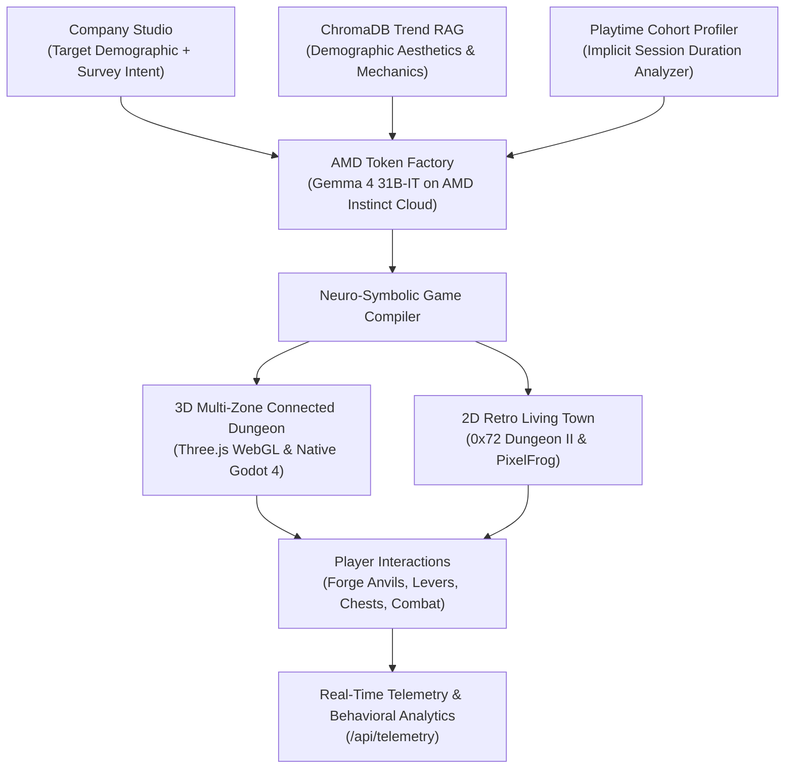

# 🎮 GENVEY — Gamified Surveys & Neuro-Symbolic AI Game Compiler
**Transforming Corporate Surveys into High-Engagement 3D & 2D Games via Gemma 4 & AMD Instinct Cloud**  
*AMD Hackathon Act 3 • Track: Create a New Kind of Experience (Entertainment, Gaming & Media)*

[](https://developer.amd.com.cn/)
[-10B981?style=for-the-badge)](https://developer.amd.com.cn/)
[](https://godotengine.org/)
[](LICENSE)

> 📖 **Developer & Agent Handoff Guide:**  
> Detailed architecture, file tree, and pipeline internals are documented in [**`AGENT_HANDOFF_DOCS.md`**](AGENT_HANDOFF_DOCS.md).

---

## 💡 The Problem: The 2% Survey Completion Crisis
Traditional corporate surveys are painful: static multiple-choice forms, dry drop-down lists, and survey fatigue result in abysmal completion rates (~2%), unreliable low-effort responses, and zero authentic consumer engagement.

## ⚡ The Solution: GENVEY
**GENVEY** replaces questionnaires with living, playable game worlds:
1. **Natural-Language Survey Intent Deconstruction**: Companies submit their business objective in natural language (e.g. *"Find out if users prefer our $10 Sovereign Tier vs $2 Micro-Tier, and whether they prioritize speed or customizability"*).
2. **AMD Token Factory (Gemma 4 31B-IT)**: Decomposes the intent into concrete in-game economic choices, mechanical levers, survey forge anvils, and branching NPC dialogues—requiring **0 MB of local VRAM**.
3. **Implicit Behavioral Telemetry**: Instead of players guessing what they might do, GENVEY measures what players *actually do* in real-time (purchasing from forge anvils, parrying enemies, choosing paths, spending gold).

---

## 🌟 Key Features & Architecture



### 1. AMD Instinct Cloud Acceleration (`Gemma-4-31B-IT`)
- **Zero Local VRAM Compute**: Complex reasoning and multi-zone procedural game generation run on remote AMD Instinct accelerators via AMD Token Factory.
- **Live Health & Latency Telemetry**: Real-time status badge and `/api/amd/status` health check measuring sub-second latency (`~890ms - 1100ms`).
- **Vision & Multimodal Support**: Integrated with `DeepSeek-V4-Flash-Vision` / `d3-flash` for automated video combat motion timing extraction.

### 2. Large 4-Zone Connected 3D Worlds (80m × 80m Scale)
- **100% Solid AABB + Sphere Sliding Physics**: Box3 bounding boxes for every wall, pillar, chest, and portcullis gate with independent X/Z sliding collision (zero wall clipping or pass-through).
- **Physical Interactive Props**:
  - **Iron Portcullis Gates & Levers (`[E] Pull Lever`)**: Smoothly raises gates and unblocks paths to adjacent zones.
  - **Gold Loot Chests (`[E] Open Chest`)**: Rotates open with gold particle bursts and awards `+10 Gold`.
  - **Survey Forge Anvils (`[E] Use Forge`)**: Directly tests pricing willingness ($10 vs $2) by checking player gold balance, equipping tier-specific weapons and armor auras.
  - **Destructible Barrels**: Attack or fireball triggers shockwave light flash, damaging adjacent enemies and clearing barricades.
- **Souls-Like Combat Engine**: Target lock-on (`[Q]`), dodge-rolling with invulnerability frames (`[Space]`), directional weapon swings (`LMB`), and active parry with 2.4× critical riposte windows (`[RMB]`).

### 3. Retro 2D Sprite Engine (`0x72_DungeonTileset_II` & `PixelFrog_Tiny_Swords`)
- **Pure Pixel Art**: Completely free of vector placeholders; renders 16×16 retro dungeon tiles with pixel smoothing disabled.
- **Multi-Frame Animated Sprites**: 4-frame animated Knights (`knight_m_idle_anim_f0..3`, run, hit), animated Skeletons, Demons, Wizard NPCs, spinning coins, potions, and weapons.
- **Affordance Interactions**: Grab and reposition crates (`[G]`), rest at Covenant Shrines (`[F]`), drink Estus flasks (`[R]`), and trigger elemental spells (`[1] Fireball`, `[2] Lockpick`).

### 4. ChromaDB Social Media Trend RAG & Cohort Playtime Profiler
- **ChromaDB Vector Store**: Persistently stores demographic gaming trends (hex palettes, slang/tone, shader styles, gameplay hooks) queried at compile time based on the target audience.
- **Implicit Playtime Profiler**: Evaluates real session durations per genre grouped by demographic traits without intrusive questions.

### 5. Dual Engine Playability: WebGL & Native Godot 4
- **WebGL In-Browser Player**: Instant zero-install play directly in browser at full viewport resolution.
- **Native Desktop Godot 4 Engine**: Generates `godot_kernel/scenes/CompiledGame.tscn` on the fly and launches a native high-performance Godot 4 desktop window with one click.

---

## 📁 Repository Directory Structure

```text
AMDHACKTHREE/
├── README.md                                 # Master Project Documentation & Quickstart
├── AGENT_HANDOFF_DOCS.md                     # Deep Architecture Guide for AI Agents & Developers
└── gamified-survey-engine/                   # Core Full-Stack Application
    ├── Dockerfile                            # Production multi-stage Docker build
    ├── docker-compose.yml                    # One-command container deployment
    ├── purge_old_games.sh                    # Script to purge old game builds & clean state
    │
    ├── backend/                              # Python 3.11 + FastAPI Backend
    │   ├── main.py                           # App entry point, REST routes & static mounts
    │   ├── compiler/
    │   │   ├── amd_client.py                 # AMD Token Factory Client (Gemma-4-31B-IT)
    │   │   ├── gemma4_architect.py           # Neuro-symbolic multi-zone compiler
    │   │   ├── trend_rag.py                  # ChromaDB demographic trend RAG
    │   │   ├── cohort_profiler.py            # Playtime session profiler
    │   │   └── video_analyzer.py             # OpenCV combat timing extractor
    │   ├── pipelines/
    │   │   ├── sync_all_user_assets.py       # Downloads, Blender converter & asset classifier
    │   │   └── godot_scene_compiler.py       # Native Godot 4 window launcher & scene generator
    │   └── storage/                          # Persistent JSON DBs & ChromaDB store
    │
    ├── custom_asset_packs/                   # 917 Indexed CC0 3D & 2D Assets
    │   ├── characters_3d/                    # Rigged hero models (Knight, Barbarian, Rogue, Mage)
    │   ├── enemies_3d/                       # Skeletons, Demons, Dragons, Slimes, PSX Killers
    │   ├── environments_3d/                  # 505 Modular castle walls, crypts, chests, gates
    │   ├── weapons_3d/                       # Swords, axes, staves, bows, daggers, shields
    │   ├── animations_3d/                    # Universal mocap animation library (86 clips)
    │   └── sprites_and_tiles_2d/             # 0x72 Dungeon II, PixelFrog Tiny Swords
    │
    ├── game_templates/                       # Teammate Game Cartridge Registry
    │   ├── cartridge_manifest.json           # Cartridge contract definitions
    │   ├── dark_souls_cathedral_gauntlet/    # Action ARPG Core
    │   ├── baldurs_gate_tactical_keep/       # Tactical CRPG (4-AP, D20 Skill Checks)
    │   └── ultima_2d_living_town/            # Living Sandbox 2D
    │
    ├── godot_kernel/                         # Native Godot 4.7 Engine Project
    │   ├── project.godot                     # Godot project settings
    │   ├── scenes/CompiledGame.tscn          # Auto-compiled 3D scene
    │   └── scripts/                          # GDScript controllers (MasterCombat, EnemyUnit)
    │
    └── frontend/                             # React 18 + Vite + Tailwind SPA
        ├── src/
        │   ├── App.jsx                       # Multi-role router (/company, /player, /play/:id)
        │   ├── GameCanvas3D.jsx              # Three.js 3D WebGL engine
        │   └── components/GameCanvas2D.jsx   # 0x72 2D retro animated sprite engine
        └── dist/                             # Pre-built production bundle
```

---

## 🚀 Quick Start Guide

### Prerequisites
- Node.js 18+ & npm
- Python 3.10+ with `pip`
- (Optional) Godot 4.x for native desktop window play

### 1. Environment Configuration
Create a `.env` file in `gamified-survey-engine/`:
```bash
AMD_API_KEY=your_amd_token_factory_key
AMD_BASE_URL=https://developer.amd.com.cn/radeon/api/v1
AMD_TEXT_MODEL=Gemma-4-31B-IT
```

### 2. Local Development Setup
```bash
# Terminal 1: Start FastAPI Backend (Port 8000)
cd gamified-survey-engine
python3 -m venv .venv
source .venv/bin/activate
pip install -r requirements.txt
uvicorn backend.main:app --port 8000 --host 0.0.0.0 --reload

# Terminal 2: Start Vite Frontend (Port 5173)
cd gamified-survey-engine/frontend
npm install
npm run dev -- --host 0.0.0.0
```

Open **`http://localhost:5173`** in your browser:
- **🏢 Company Studio (`/company`)**: Enter demographic & survey intent to compile customized 3D or 2D games with live AMD health status.
- **🎮 Player Library (`/player`)**: Browse and play all compiled games.
- **▶ Fullscreen Game (`/play/:gameId`)**: Experience true fullscreen 3D or 2D gameplay.

---

## 🐳 One-Command Cloud Container Deployment

GENVEY includes a production-ready `Dockerfile` and `docker-compose.yml` for zero-configuration deployment on container hosts (Google Cloud Run, Oracle Cloud Always Free, Caasify):

```bash
cd gamified-survey-engine

# Build and start containerized stack
docker compose up --build -d

# Check live health status
curl http://localhost:8000/api/health
curl http://localhost:8000/api/amd/status
```

---

## 📡 Key REST API Endpoints

| Method | Endpoint | Description |
| :--- | :--- | :--- |
| `GET` | `/api/amd/status` | Live health check verifying AMD Token Factory & Gemma 4 latency |
| `GET` | `/api/health` | Basic service health verification |
| `POST` | `/api/compile` | Compiles demographic & survey intent into playable 3D/2D games |
| `GET` | `/api/games` | Returns list of all compiled game campaigns |
| `GET` | `/api/games/{id}` | Retrieves full JSON configuration for a specific game |
| `POST` | `/api/godot/launch-native` | Launches game in a native desktop Godot 4 window |
| `GET` | `/api/trends` | Returns ChromaDB demographic gaming trends |
| `GET` | `/api/cohort/playtime` | Returns implicit demographic playtime session stats |
| `POST` | `/api/telemetry` | Logs player behavioral events (forge purchases, chest opens, parries) |
| `GET` | `/api/analytics` | Returns aggregated survey analytics & choice distributions |

---

## 🏆 AMD Hackathon Track Alignment
- **Track**: *Create a New Kind of Experience (Entertainment, Gaming & Media)*
- **Impact**: Replaces mundane forms with playable entertainment, increasing response fidelity, immersion, and engagement while offloading heavy LLM inference to **AMD Instinct Cloud Accelerators**.

---

## 📄 License
This project is licensed under the MIT License. See [LICENSE](LICENSE) for details.
All bundled 3D models and 2D sprites are CC0 / Free Cultural Works licensed (Quaternius, Kenney, 0x72, PixelFrog).